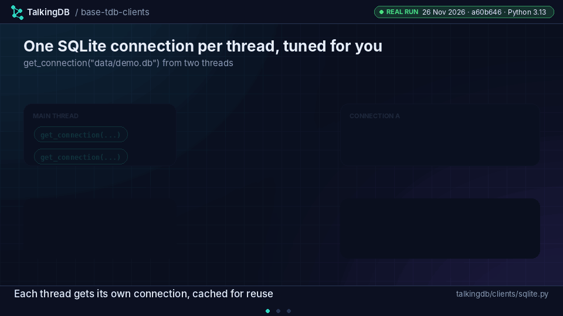

# base-tdb-clients

Shared connections to outside systems for TalkingDB services: [SQLite](https://www.sqlite.org/about.html) databases, [MinIO](https://en.wikipedia.org/wiki/MinIO) file storage, and structured logging.


<p align="center">
  
</p>
<p align="center"><sub>A real run at <code>a60b646</code> with Python 3.13.18, 26 Nov 2026.</sub></p>

| Start here | Go deeper |
| :--- | :--- |
| [What it is](#what-it-is) | [Architecture](docs/architecture.md) |
| [Where this fits](#where-this-fits) | [Usage and examples](docs/usage-and-examples.md) |
| [Quickstart](#quickstart) | [Troubleshooting](docs/troubleshooting.md) |
| [Configuration](#configuration) | [What this repo is not](#what-this-repo-is-not) |

All pages: [docs/](docs/README.md).

## What it is

A **client** is the small piece of code that opens and reuses a connection to something outside Python, so every service does it the same way. This library has three:

| Client | File | What it does |
| :--- | :--- | :--- |
| SQLite | [`talkingdb/clients/sqlite.py`](talkingdb/clients/sqlite.py) | Opens one connection per database file per thread, with WAL mode and a busy timeout already set |
| MinIO | [`talkingdb/clients/minio.py`](talkingdb/clients/minio.py) | An optional, shared client for MinIO, an S3 compatible file store. Off unless both keys are set |
| Logging | [`talkingdb/logger/`](talkingdb/logger/) | A coloured console logger and a `@track()` decorator that writes one JSON line per call to `logs/talkingdb/` |

**WAL** (write ahead logging) is a SQLite mode that lets readers keep reading while one writer writes. A **busy timeout** makes a writer wait for the lock instead of failing at once.

## Where this fits

<picture>
  <source media="(prefers-color-scheme: dark)" srcset="docs/images/where-base-tdb-clients-fits-dark.svg">
  
</picture>

<sub>Diagram source: [where-base-tdb-clients-fits.mmd](docs/diagrams/where-base-tdb-clients-fits.mmd). Edit it and re-render with the steps in [docs/diagrams](docs/diagrams/README.md).</sub>

In words: services and helpers ask this library for connections; it talks to SQLite files on local disk, to MinIO only when configured, and writes call logs as JSON lines.

## Quickstart

You need Python 3.12 or 3.13 and [Poetry](https://python-poetry.org/docs/#installation).

```bash
git clone https://github.com/TalkingDB/base-tdb-clients.git
cd base-tdb-clients
poetry install
poetry run python -c "from talkingdb.clients.sqlite import get_connection; print(get_connection('data/demo.db').execute('PRAGMA journal_mode').fetchone()[0])"
```

That prints `wal` and creates `data/demo.db` (the folder is created for you).

## Configuration

All settings are environment variables, read once when the module is first imported.

| Variable | Default | Used for |
| :--- | :--- | :--- |
| `GRAPH_DB` | `data/graphs.db` | Document and [knowledge graphs](https://en.wikipedia.org/wiki/Knowledge_graph) |
| `ENTITY_DB` | `data/entities.db` | Entities and facts |
| `DICTIONARY_DB` | `data/dictionary.db` | Spelling correction dictionary |
| `REGEX_DB` | `data/regex.db` | Regular expression rules |
| `TDB_SQLITE_BUSY_TIMEOUT_MS` | `30000` | How long a writer waits for the lock |
| `MINIO_ENDPOINT` | set in [minio.py](talkingdb/clients/minio.py) | MinIO host |
| `MINIO_ACCESS_KEY`, `MINIO_SECRET_KEY` | empty | Both must be set to turn MinIO on |
| `MINIO_SECURE` | `true` | Use HTTPS to MinIO |
| `MINIO_BUCKET` | `ttt` | Bucket name |

> [!IMPORTANT]
> Set these before the first `import talkingdb...` in your process. The values are read at import time, so changing `os.environ` afterwards has no effect.

## What this repo is not

- **Not a data model.** The shapes stored in these databases live in [base-tdb-models](https://github.com/TalkingDB/base-tdb-models).
- **Not an ORM or migration tool.** It opens connections; it does not create tables or migrate them.
- **Not a server.** Nothing here listens on a port.
- **Not a required MinIO dependency.** Services run without MinIO; storage features turn themselves off with a warning.

## Related repositories

| Repository | Relationship |
| :--- | :--- |
| [base-tdb-models](https://github.com/TalkingDB/base-tdb-models) | Models that read and write through these connections |
| [base-tdb-helpers](https://github.com/TalkingDB/base-tdb-helpers) | File store, job store and graph cache built on these clients |
| [module-ttt](https://github.com/TalkingDB/module-ttt) | Uses MinIO for original files and SQLite for graphs and jobs |
| [package-named-entity-linker](https://github.com/TalkingDB/package-named-entity-linker) | Reads `ENTITY_DB`, `DICTIONARY_DB` and `REGEX_DB` |

## Further reading

- [SQLite write ahead logging](https://www.sqlite.org/wal.html)
- [SQLite PRAGMA busy_timeout](https://www.sqlite.org/pragma.html#pragma_busy_timeout)
- [MinIO Python SDK](https://github.com/minio/minio-py)
- [Python sqlite3 and threads](https://docs.python.org/3/library/sqlite3.html#sqlite3.connect)

## Code contributor

mayank.g@smarter.codes

## Support TalkingDB

If base-tdb-clients saved you time, please [give it a star](https://github.com/TalkingDB/base-tdb-clients) ⭐. Stars help other developers find the project.

Found a bug, or a document it gets wrong? [Open an issue](https://github.com/TalkingDB/base-tdb-clients/issues/new). We are always here to help and open to a conversation. Explore the TalkingDB applications at [talkingdb.io](https://talkingdb.io/#applications).

## License

Licensed under the GNU Affero General Public License v3.0 ([AGPL-3.0](https://www.gnu.org/licenses/agpl-3.0.html)). See [LICENSE](LICENSE).
