# Architecture

[Docs home](README.md) › Architecture

How the three clients in `base-tdb-clients` work, and the behaviour callers rely on. For setup, start at the [README](../README.md).

## SQLite: one connection per file per thread

<picture>
  <source media="(prefers-color-scheme: dark)" srcset="images/how-get-connection-reuses-sqlite-connections-dark.svg">
  
</picture>

<sub>Diagram source: [how-get-connection-reuses-sqlite-connections.mmd](diagrams/how-get-connection-reuses-sqlite-connections.mmd). Edit it and re-render with the steps in [docs/diagrams](diagrams/README.md).</sub>

In words: each thread gets its own connection per database file, opened once with the same settings, and reused after that.

Behaviour that callers depend on ([sqlite.py](../talkingdb/clients/sqlite.py)):

| Behaviour | Why it matters |
| :--- | :--- |
| `isolation_level=None` (autocommit) | Each statement commits on its own unless the caller runs `BEGIN` itself, as `GraphModel.save` does |
| `row_factory = sqlite3.Row` | Rows can be read by column name |
| Cached per thread, keyed by path | Two threads never share a connection; the same thread always gets the same one |
| `sqlite_conn(path)` does not close | It is a convenience wrapper; the cached connection stays open for reuse |
| Connections are never closed by this library | On Windows the database files stay locked until the process exits, so temporary folders cannot always be deleted |

## MinIO: optional, created on first use

[minio.py](../talkingdb/clients/minio.py) keeps one client per process, created under a lock the first time `get_minio_client()` is called.

- `is_configured()` is true only when both `MINIO_ACCESS_KEY` and `MINIO_SECRET_KEY` are set.
- `get_minio_client()` raises `RuntimeError("MinIO is not configured.")` when it is not. Callers are expected to check `is_configured()` first and skip storage.
- `ensure_bucket()` creates `MINIO_BUCKET` if it is missing, and only logs a warning when [MinIO](https://en.wikipedia.org/wiki/MinIO) is not configured.

## Logging: console plus JSON lines

<picture>
  <source media="(prefers-color-scheme: dark)" srcset="images/where-track-writes-its-log-lines-dark.svg">
  
</picture>

<sub>Diagram source: [where-track-writes-its-log-lines.mmd](diagrams/where-track-writes-its-log-lines.mmd). Edit it and re-render with the steps in [docs/diagrams](diagrams/README.md).</sub>

In words: every tracked call is written to at least two JSON lines files under `logs/talkingdb/`, and to a third, scoped file when the request carries a scope.

- [`track.py`](../talkingdb/logger/track.py): the `@track()` decorator, for normal and `async` functions. It records duration, status and, on failure, the traceback.
- [`context.py`](../talkingdb/logger/context.py): `set_log_context(**fields)` adds fields such as `scope`, `event_group_id` and `service` to every entry in the current context.
- [`file.py`](../talkingdb/logger/file.py): writes the entries. The root is `logs/talkingdb`, relative to the working directory.
- [`console.py`](../talkingdb/logger/console.py): a coloured `logging` handler on standard output.

## Who depends on this

All TalkingDB Python packages and modules pin this library by commit. As of 25 November 2026 every consumer pins `29abea2`, which is also the head of `main`. Recheck with:

```bash
grep -n 'base-tdb-clients.git' */pyproject.toml
```

---

**Related:** [Troubleshooting](troubleshooting.md) · [Usage and examples](usage-and-examples.md) · [README](../README.md)
