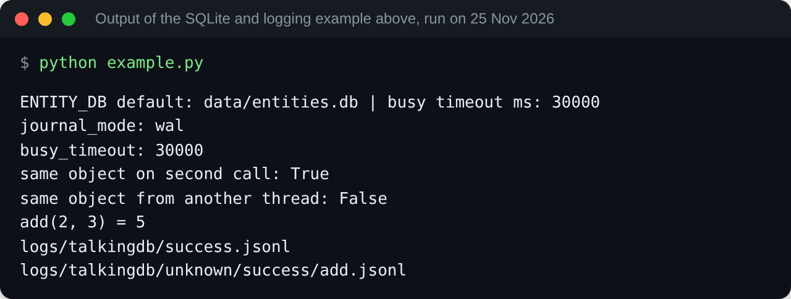

# Usage and examples

[Docs home](README.md) › Usage and examples

> [!NOTE]
> The outputs below come from a run on 25 November 2026 with Python 3.13, against commit `29abea2`, started in an empty folder.

## Open a SQLite database

```python
import threading
from talkingdb.clients.sqlite import get_connection, ENTITY_DB, SQLITE_BUSY_TIMEOUT_MS

print("ENTITY_DB default:", ENTITY_DB, "| busy timeout ms:", SQLITE_BUSY_TIMEOUT_MS)
conn = get_connection("data/demo.db")
print("journal_mode:", conn.execute("PRAGMA journal_mode").fetchone()[0])
print("busy_timeout:", conn.execute("PRAGMA busy_timeout").fetchone()[0])
print("same object on second call:", conn is get_connection("data/demo.db"))

other = {}
t = threading.Thread(target=lambda: other.setdefault("c", get_connection("data/demo.db")))
t.start(); t.join()
print("same object from another thread:", other["c"] is conn)
```

Output:

```text
ENTITY_DB default: data/entities.db | busy timeout ms: 30000
journal_mode: wal
busy_timeout: 30000
same object on second call: True
same object from another thread: False
```



<sub>Screenshot of the real command and its unedited output, 25 Nov 2026.</sub>

Use it with a model from [base-tdb-models](https://github.com/TalkingDB/base-tdb-models):

```python
from talkingdb.clients.sqlite import get_connection, ENTITY_DB
from talkingdb.models.entity.entity import EntityModel

conn = get_connection(ENTITY_DB)
EntityModel.init_db(conn)
```

## Point services at different database files

```bash
export ENTITY_DB=/srv/tdb/entities.db
export DICTIONARY_DB=/srv/tdb/dictionary.db
export REGEX_DB=/srv/tdb/regex.db
export TDB_SQLITE_BUSY_TIMEOUT_MS=60000
```

Set them before the service starts. They are read when `talkingdb.clients.sqlite` is first imported.

## Log a function call

```python
from talkingdb.logger.track import track

@track()
def add(a, b):
    return a + b

print("add(2, 3) =", add(2, 3))
```

Files created under the working directory:

```text
logs/talkingdb/success.jsonl
logs/talkingdb/unknown/success/add.jsonl
```

One line from `success.jsonl`:

```json
{"client": "unknown", "function": "add", "module": "__main__.add", "status": "success", "duration_ms": 0, "timestamp": "2026-11-25T15:41:33.994004"}
```

`client` is `unknown` here because the function is not a method on a client class. Add request fields to every entry with `set_log_context(scope=..., event_group_id=..., service=...)` from [`talkingdb.logger.context`](../talkingdb/logger/context.py).

## Use MinIO only when it is configured

```python
from talkingdb.clients.minio import is_configured, get_minio_client, MINIO_BUCKET

if is_configured():
    client = get_minio_client()
    client.fput_object(MINIO_BUCKET, "originals/report.pdf", "report.pdf")
else:
    print("MinIO is off; skipping upload")
```

Higher level helpers for uploads, presigned links and deletes live in [base-tdb-helpers `file_store.py`](https://github.com/TalkingDB/base-tdb-helpers/blob/main/talkingdb/helpers/file_store.py).

---

**Related:** [Architecture](architecture.md) · [Troubleshooting](troubleshooting.md) · [README](../README.md)
